# BUSORA – UML Class Diagram

This diagram visualizes the Object-Oriented design of **BUSORA**, detailing the domain classes, inheritance hierarchies, interfaces (abstraction), and polymorphic relationships.

```mermaid
classDiagram
    direction TB

    %% Abstraction Interfaces
    class FareCalculator {
        <<interface>>
        +calculateGrossFare(Bus bus, int seatCount) double
        +calculateTaxes(double grossAmount) double
        +calculateDiscount(double grossAmount, String couponCode) double
        +calculateFinalPayable(Bus bus, int seatCount, String couponCode) double
        +getPolicyName() String
    }

    class PaymentProcessor {
        <<interface>>
        +processPayment(Booking booking, String channelDetails) Payment
        +refundPayment(String transactionId, double amount) boolean
        +getChannelName() String
    }

    class NotificationService {
        <<interface>>
        +sendBookingConfirmation(Booking booking) void
        +sendCancellationAlert(Booking booking) void
        +getChannelType() String
    }

    %% Polymorphic Implementations
    class StandardFareCalculator {
        +calculateGrossFare(Bus bus, int seatCount) double
        +calculateTaxes(double grossAmount) double
        +calculateDiscount(double grossAmount, String couponCode) double
    }

    class LuxuryFareCalculator {
        +calculateGrossFare(Bus bus, int seatCount) double
        +calculateTaxes(double grossAmount) double
        +calculateDiscount(double grossAmount, String couponCode) double
    }

    class UPIPaymentProcessor {
        +processPayment(Booking booking, String vpaId) Payment
        +refundPayment(String transactionId, double amount) boolean
    }

    class CardPaymentProcessor {
        +processPayment(Booking booking, String cardToken) Payment
        +refundPayment(String transactionId, double amount) boolean
    }

    class EmailNotificationService {
        +sendBookingConfirmation(Booking booking) void
        +sendCancellationAlert(Booking booking) void
    }

    class SMSNotificationService {
        +sendBookingConfirmation(Booking booking) void
        +sendCancellationAlert(Booking booking) void
    }

    FareCalculator <|.. StandardFareCalculator : implements
    FareCalculator <|.. LuxuryFareCalculator : implements
    PaymentProcessor <|.. UPIPaymentProcessor : implements
    PaymentProcessor <|.. CardPaymentProcessor : implements
    NotificationService <|.. EmailNotificationService : implements
    NotificationService <|.. SMSNotificationService : implements

    %% Domain Entities
    class User {
        -Long id
        -String fullName
        -String email
        -String password
        -String phone
        -Role role
        -LocalDateTime createdAt
        +hasAdminPrivileges() boolean
        +addBooking(Booking booking) void
    }

    class Route {
        -Long id
        -String sourceCity
        -String destinationCity
        -double distanceKm
        -double estimatedDurationHours
        -boolean active
        +getRouteSummary() String
    }

    class Bus {
        -Long id
        -String busNumber
        -String operatorName
        -BusType busType
        -int totalSeats
        -double baseFare
        -LocalTime departureTime
        -LocalTime arrivalTime
        -double rating
        -String amenities
        -boolean active
        +calculateDynamicFare(int seatCount) double*
        +calculateFare(int seats) double
        +calculateFare(int seats, double surgeMultiplier) double
        +calculateFare(int seats, double surge, double discount) double
        +getComfortLevel() String*
        +getCategoryBadge() String*
        +getAvailableSeatsCount() int
    }

    class ACBus {
        +calculateDynamicFare(int seatCount) double
        +getComfortLevel() String
        +getCategoryBadge() String
    }

    class SleeperBus {
        +calculateDynamicFare(int seatCount) double
        +getComfortLevel() String
        +getCategoryBadge() String
    }

    class NonACBus {
        +calculateDynamicFare(int seatCount) double
        +getComfortLevel() String
        +getCategoryBadge() String
    }

    class SeaterBus {
        +calculateDynamicFare(int seatCount) double
        +getComfortLevel() String
        +getCategoryBadge() String
    }

    %% Inheritance
    Bus <|-- ACBus : extends
    Bus <|-- NonACBus : extends
    Bus <|-- SeaterBus : extends
    ACBus <|-- SleeperBus : extends

    class Seat {
        -Long id
        -String seatNumber
        -String deckLevel
        -String seatType
        -boolean booked
        -boolean ladiesReserved
        +reserveSeat() void
        +releaseSeat() void
    }

    class Booking {
        -Long id
        -String pnrNumber
        -LocalDate journeyDate
        -LocalDateTime bookingDate
        -double totalAmount
        -double discountAmount
        -double finalAmount
        -BookingStatus status
        -String couponApplied
        +addPassenger(Passenger passenger) void
        +cancelBooking() void
        +isCancellable() boolean
    }

    class Passenger {
        -Long id
        -String passengerName
        -int age
        -String gender
    }

    class Payment {
        -Long id
        -String transactionId
        -String paymentMethod
        -double amount
        -PaymentStatus paymentStatus
        -LocalDateTime paymentDate
    }

    %% Associations & Compositions
    Route "1" <-- "*" Bus : route_id (Association)
    Bus "1" *-- "*" Seat : seats (Composition)
    User "1" --> "*" Booking : bookings (Association)
    Bus "1" <-- "*" Booking : bus (Association)
    Booking "1" *-- "1..*" Passenger : passengers (Composition)
    Seat "1" <-- "1" Passenger : seat (Association)
    Booking "1" *-- "1" Payment : payment (Composition)
```

